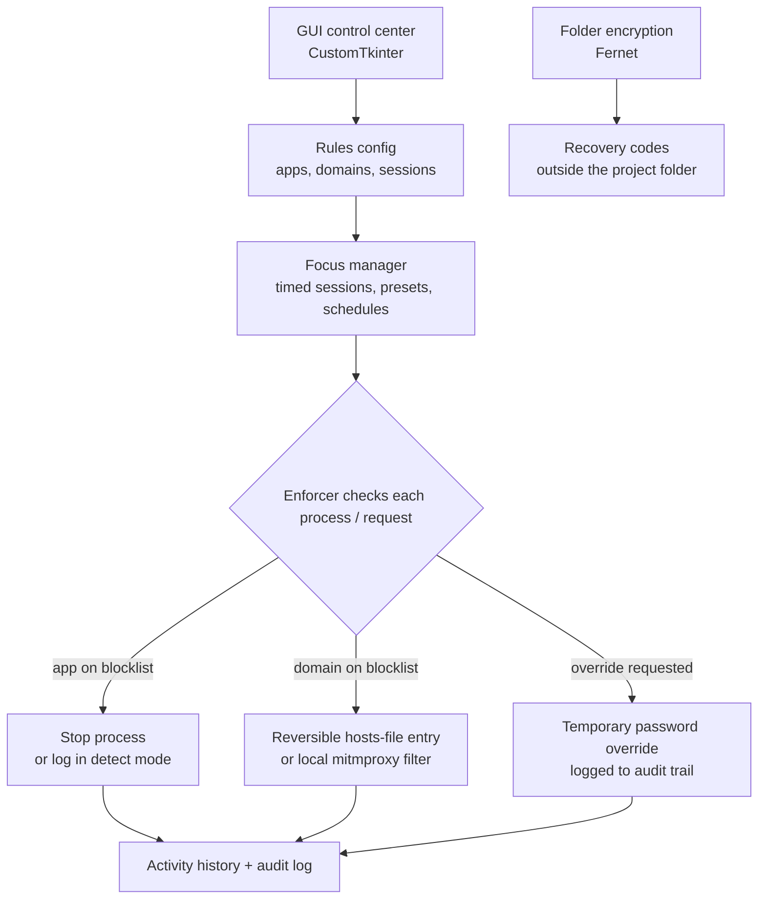
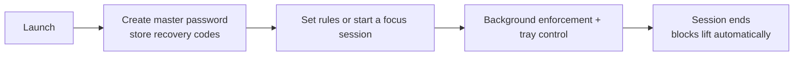

# WindsLock

A desktop focus-control prototype for Windows that can stop selected applications, block configured domains, create scheduled focus sessions, and encrypt chosen folders. It includes a graphical control center, background enforcement, tray controls, recovery codes, and build tooling.

## Features

- Application rules by process name or executable path
- Strict blocking or detect-and-log mode
- Domain blocking through reversible Windows host entries
- Optional path-level filtering through a local proxy
- Timed focus sessions, presets, and weekly schedules
- Temporary password-based overrides
- Folder encryption and recovery workflow
- Activity history and diagnostics
- Tray controller and Windows startup options

## Important limitations

- This is a user-level focus tool, not enterprise endpoint security.
- A Windows administrator can stop or bypass its enforcement.
- Browser Secure DNS, alternate browsers, or proxy settings can bypass website rules.
- Path-level HTTPS filtering requires a local proxy certificate and can inspect traffic while active.
- Folder encryption can cause permanent data loss if passwords, recovery codes, and backups are lost.

Test only with disposable folders and harmless applications until you understand the recovery flow.

## Tech stack

- Python 3.11+
- CustomTkinter
- Cryptography and Fernet
- psutil
- mitmproxy
- pystray and Pillow
- PyInstaller

## Run from source

~~~powershell
git clone https://github.com/saishivasanjeethpaikarao-jpg/WindsLock.git
cd WindsLock
py -m pip install -r requirements.txt
python main.py
~~~

On first run, create a master password and store the generated recovery codes outside the project folder.

Convenience launchers are also included:

~~~text
run_windslock.bat
run_windslock_pro.bat
run_tray.bat
run_windslock_admin.bat
~~~

Administrator access is needed when applying or removing Windows website-blocking entries and for some startup options.

## Build

~~~powershell
build_portable_exe.bat
~~~

Build and release details are documented in [docs/BUILD_RELEASES.md](docs/BUILD_RELEASES.md).

## Documentation

- [Architecture and mind maps](docs/MIND_MAPS.md)
- [Workflows](docs/WORKFLOWS.md)
- [Cross-platform plan](docs/CROSS_PLATFORM_PLAN.md)
- [Build and release guide](docs/BUILD_RELEASES.md)
- [Code-signing guide](docs/CODE_SIGNING.md)
- [Roadmap](docs/ROADMAP.md)

## Security notes

WindsLock is still a prototype. Keep backups, review the code before protecting important data, and use signed releases for wider distribution. Do not install the local proxy certificate unless you understand and accept the HTTPS inspection model.

## Enforcement flow

## At a glance

